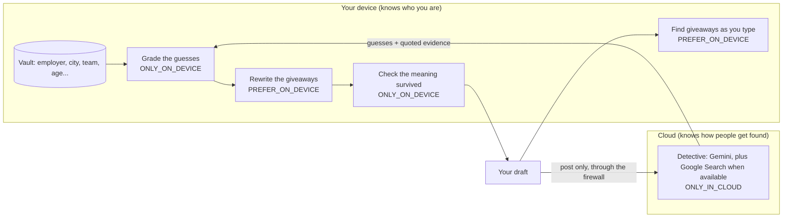

# OneOfMany

**Your account is anonymous. Is your post?**

Before you post anonymously (on Reddit, Glassdoor, Blind, a staff forum, or in a whistleblower report), OneOfMany sends an AI detective after your draft. A cloud Gemini model reads only the post and tries to work out who wrote it. Gemini Nano, running on your own computer, privately checks which guesses were right against a vault of who you really are, then helps you rewrite the lines that gave you away, and checks that the rewrite still says what you meant.

The cloud never learns who you are. Your device never has to play the attacker. That split is the product, and it only works with hybrid inference.

Built with **Firebase AI Logic** for **Web (Chrome desktop)**. Licensed under Apache-2.0.

- Live app: _add the Firebase Hosting URL_
- Demo video: _add the YouTube link_

---

## The problem

Removing your name doesn't make a post anonymous. The details do the work: "the only woman engineer on the settlement team", "our office in Bellandur", "since the reorg in March".

AI has made those details much easier to exploit:

- **Nov 2026, Northeastern University.** Researchers built 822 fictional interviews from public information about people found through Reddit AMAs, scrubbed the names, and asked AI models to identify the speakers. The strongest systems identified roughly 400 of them. The interviews were constructed from public information, so this shows a practical risk rather than a universal re-identification rate. ([Northeastern Global News](https://news.northeastern.edu/2026/11/24/ai-identify-anonymous-users/))
- **Jan 2026, Northeastern University.** An earlier paper re-identified participants in a publicly released set of "anonymised" interviews using widely available LLMs. ([arXiv 2601.05918](https://arxiv.org/abs/2601.05918))
- **ICLR 2024, ETH Zurich.** LLMs inferred personal attributes such as location, income and sex from real Reddit profiles with up to 85% top-1 accuracy, far faster and cheaper than people. ([arXiv 2310.07298](https://arxiv.org/abs/2310.07298))
- **2026, Lermen et al.** LLM agents inferred where people live and what they do from a handful of comments, then searched for them on the web. ([summary](https://simonlermen.substack.com/p/large-scale-online-deanonymization))
- **Trust is already low.** Gartner found only 29% of employees trust their organisations with data from feedback processes ([SHRM](https://www.shrm.org/resourcesandtools/hr-topics/technology/pages/worker-mistrust-leads-flawed-data-engagement-surveys.aspx)), and Glassdoor's 2024 real-name change set off a backlash from users who feared their reviews could be tied back to them ([TechCrunch](https://techcrunch.com/?p=2681423)).

**Who it's for:** employees writing about their workplace, nurses and frontline staff reporting unsafe conditions, students writing about advisors, people in support communities, and journalists or researchers publishing anonymised quotes.

Existing tools either strip names with pattern matching, or "anonymise" your text by sending your raw, identifying draft to a cloud AI. Neither tests the draft against a realistic attacker, and the second hands your identity to a third party in order to protect it.

---

## How it works

The screen is split the way the system is split. The left half is **your device**: the draft, its giveaways and your sealed vault. The right half is **the cloud**: the detective and the file it builds on you. A firewall seam runs between them and shows, live, how many vault values have crossed it (always 0).



1. **Write.** As you type, deterministic rules and Gemini Nano underline each giveaway in the draft, from a dotted line for a small clue to red for words the detective actually used against you. Each one can be blurred on the device in one click, with undo. On-device inference is free and works offline, so this runs on every pause.
2. **Send the detective.** A cloud Gemini model plays a skilled investigator. It sees only the post and returns guesses for ten facts (employer, industry, city, country, team, role, seniority, time at the job, age, gender) with confidence, quoted evidence, and a rough size of the crowd you'd hide in. If you add earlier posts from the same account, it also attacks the draft together with them, because clues add up across posts. The detective steps down automatically (strong model with search, fast model with search, strong model, fast model) and remembers for the session which options were slow or unavailable.
3. **Private grading.** Gemini Nano compares each guess with your vault, on your device. Synonyms and old names count ("Bangalore" is "Bengaluru"). The detective's file shows one row per fact, marked Found, Close or Missed, plus an exposure score and a ten-cell strip of the same facts. Unknown values and wrong guesses stay under a redaction bar: wrong guesses are never shown. Pointing at a row draws a line back to the words that gave it away.
4. **Rewrite.** Nano suggests vaguer wording for each giveaway, shown as a diff. Apply the ones you like. A **meaning kept** check then compares the rewrite with your original, on your device, so you don't scrub away your own point.
5. **Re-test.** Send the detective again. Every run is kept, so you can watch exposure fall run by run.

---

## Why hybrid, job by job

| Job | Inference mode | Why this mode |
| --- | --- | --- |
| Find giveaways | `PREFER_ON_DEVICE` | Runs on every pause in typing, so it must be free and offline-capable. The draft is about to be public, so a cloud fallback is acceptable, but without a local model it only runs when you ask. |
| Detective | `ONLY_IN_CLOUD`, plus Google Search when the plan allows | A real attacker uses the strongest model and the web. The attack only means something if the attacker doesn't know the answer, so it never gets the vault. |
| Grade guesses | `ONLY_ON_DEVICE` | The prompt contains your vault. There is no cloud fallback: without Nano, deterministic matching grades instead and you can correct any row. |
| Rewrite giveaways | `PREFER_ON_DEVICE` | Clues sent for rewriting are chosen from the detective's evidence and high-risk giveaways, never from the vault or from which guesses were right, so even a cloud fallback learns nothing new. |
| Meaning kept | `ONLY_ON_DEVICE` | Compares the original with the rewrite. The original holds the clues you chose not to publish, so it doesn't go anywhere again. Without Nano, a deterministic check answers instead. |

Every result shows its real `inferenceSource` from the SDK, never a guess: "On this device" or "In the cloud".

---

## Privacy design

- **Two kinds of data, two places.** What you're about to publish may go to the cloud. Who you are never does.
- **Profile firewall.** Every cloud-capable request passes through [`src/engine/firewall.ts`](src/engine/firewall.ts). If it contains a vault value that isn't already in your public text, the request is blocked before it's sent.
- **Cloud receipt.** A drawer lists every AI call in the tab: task, routing, real inference source, latency, firewall result and the exact text sent. It re-audits every cloud payload against the vault, independently of the firewall, and shows "vault values sent: 0".
- **Firewall self-test.** "Run firewall test" deliberately builds a request containing a vault value and pushes it through the real firewall. It's blocked before dispatch. The test uses a stub model that can't reach the network, so even a broken firewall would leak nothing.
- **Device-only means device-only.** Before any `ONLY_ON_DEVICE` job is dispatched, the app checks Chrome's `LanguageModel` availability itself and refuses to send if no local model is ready.
- **Wrong guesses stay hidden.** The app only confirms what the detective got right about the person in the vault, and asks you to confirm a draft is your own before attacking it.
- **Nothing stored server-side.** Firestore holds a single opt-in counter of giveaway *types*. No text, no vaults, no accounts beyond anonymous auth. Drafts live in session storage and disappear with the tab.
- **No names, ever.** The detective is instructed never to output names, usernames, emails, phone numbers or addresses, and its output schema has no field for them.
- **No debug token in production.** The App Check debug token is only referenced inside a development-only branch, so production builds never contain it.

### Known limits

We'd rather name these than have a reviewer find them:

- **Confirmation misuse.** Someone could paste another person's post and fill the vault with their suspicions about that person; the match count would then confirm or deny the suspicion. Hiding wrong guesses and the own-draft confirmation reduce this but don't prevent it.
- **Differences between drafts.** The cloud sees every version you test. Suggested rewrites are chosen without the vault and each detective call is stateless, so our edits don't map to correct guesses. Edits you make by hand could.
- **One run is one sample.** The detective is a language model; two runs on the same text can differ. Treat a low score as "harder to find", not "safe".
- **Up to three earlier posts.** Real attackers can read an account's whole history.
- **Text only.** Posting times, account history, writing style and file metadata can also identify you.
- **The cloud provider processes your draft**, which is text you intend to publish. Your vault never leaves the device.

---

## Firebase products used

| Product | Where | What it does here |
| --- | --- | --- |
| **Firebase AI Logic** (hybrid inference) | [`src/ai/models.ts`](src/ai/models.ts), [`src/ai/run.ts`](src/ai/run.ts), [`src/ai/tasks.ts`](src/ai/tasks.ts) | Model instances with different `InferenceMode`s per job; structured JSON output on both paths; Google Search grounding; `initializeDeviceModel()` for the one-time Nano download |
| **App Check** | [`src/firebase.ts`](src/firebase.ts) | reCAPTCHA Enterprise protects the Gemini API from abuse (debug tokens in development only) |
| **Remote Config** | [`src/firebase.ts`](src/firebase.ts), [`remoteconfig.template.json`](remoteconfig.template.json) | Detective model, fallback model, search on or off, confidence threshold and the meaning check can be changed live |
| **Authentication** | [`src/firebase.ts`](src/firebase.ts) | Anonymous sign-in for the opt-in counter |
| **Cloud Firestore** | [`src/store.ts`](src/store.ts), [`firestore.rules`](firestore.rules) | Opt-in community counts of giveaway types, with rules that only allow small increments |
| **Hosting** | [`firebase.json`](firebase.json) | Optional: the app also deploys to Firebase Hosting with the same strict headers it uses on Vercel |

Where Firebase AI Logic is called at runtime:

- `getGenerativeModel(ai, { mode, inCloudParams, onDeviceParams })` in [`src/ai/models.ts`](src/ai/models.ts)
- `model.generateContent(prompt)` and `response.inferenceSource` in [`src/ai/run.ts`](src/ai/run.ts)
- `model.initializeDeviceModel(onProgress)` in [`src/ai/models.ts`](src/ai/models.ts)
- One JSON Schema per job, passed as `responseConstraint` (Chrome Prompt API) and `responseJsonSchema` (Gemini), in [`src/ai/schemas.ts`](src/ai/schemas.ts)

---

## Try it

**Hosted:** open the live app in desktop Chrome, pick a sample story under "Try a story" (the people and employers are fictional), and click **Send the detective**. Then click **Cool down these giveaways**, apply the rewrites, and send the detective again. Open **Cloud receipt** to see every call and run the firewall test.

**For on-device inference** (optional; everything works without it):

1. In `chrome://flags`, enable **Prompt API for Gemini Nano** (on newer Chrome, also "Gemma 4 for Built-in AI") and **Prompt API for Gemini Nano with Multimodal Input**, then relaunch Chrome.
2. In the app, open the vault and click **Download on-device model** once. Keep Chrome open until the header says "Gemini Nano ready". `chrome://on-device-internals` shows progress.

Gemini Nano needs at least 22 GB of free storage and either a GPU with more than 4 GB of VRAM or 16 GB of RAM with 4 CPU cores. Without it, grading and the meaning check use deterministic rules, and the giveaway scan offers a deep scan in the cloud.

---

## Run it locally

Requirements: Node 20 or newer, desktop Chrome.

1. **Firebase project.** In the [Firebase console](https://console.firebase.google.com), create a project. Go to **AI Services > AI Logic**, click **Get started**, and choose the **Gemini Developer API** (no billing needed). Google Search grounding needs the Blaze plan; without it the detective runs from the text alone and says so.
2. **Web app.** Project settings > Your apps > add a **Web** app and copy its config.
3. **App Check.** App Check > Apps > your web app > register with **reCAPTCHA Enterprise** (a key for `localhost` and your Hosting domains), then enforce App Check for **Firebase AI Logic**.
4. **Firestore and Auth.** Create a Firestore database in production mode, and enable the **Anonymous** provider under Authentication.
5. **Configure and run.**
   ```bash
   cp .env.example .env.local   # fill in the values
   npm install
   npm run dev                  # http://localhost:5173
   ```
   On first run, the browser console prints an App Check debug token. Add it under App Check > Apps > Manage debug tokens, and set it as `VITE_APPCHECK_DEBUG_TOKEN` in `.env.local`. It's only ever used by the dev server.

### Deploy

**Vercel** (what the live app uses). Import the GitHub repo in Vercel; `vercel.json` sets the build. Add the `VITE_FIREBASE_*` values and `VITE_RECAPTCHA_ENTERPRISE_SITE_KEY` as environment variables (never the debug token), then add the Vercel domain to the reCAPTCHA Enterprise key's allowed domains in Google Cloud. Firestore rules and the Remote Config template still deploy with the Firebase CLI:

```bash
firebase deploy --only firestore:rules,remoteconfig
```

**Firebase Hosting** works too:

```bash
npm install -g firebase-tools
firebase login
firebase use <your-project-id>
npm run deploy   # builds, then deploys Hosting, Firestore rules and the Remote Config template
```

### Checks

```bash
npm run check    # type check, lint, and the test suite
```

The tests cover the deterministic engine (giveaways, grading, firewall, fixes, meaning kept), the receipt audit, the firewall self-test and the benchmark summary.

---

## Benchmark

Open `#bench` (the link is in the footer). Thirty fictional people each have an anonymous post and a full vault. For every post the detective attacks, every suggested rewrite is applied, and the detective attacks again. Guesses are graded with the deterministic rules so anyone can reproduce the numbers. Progress is saved in the browser, and results can be copied as Markdown or downloaded as JSON.

<!-- Paste the Markdown from #bench here after a full run. -->

---

## Project structure

```
src/
  ai/
    models.ts     one Firebase AI Logic model per job and inference mode
    run.ts        firewall check, device-only guard, receipt entry, real inferenceSource
    tasks.ts      findTells, runDetective, gradePrivately, suggestFixes, checkMeaning, testFirewall
    prompts.ts    prompts (instructions live in the user turn for Chrome's on-device path)
    schemas.ts    JSON Schemas shared by on-device and cloud
    device.ts     reads Chrome's LanguageModel availability
    receipt.ts    the cloud receipt log and its independent audit
  engine/         deterministic and tested, no AI: giveaways, grading, firewall, fixes, meaning kept
  bench/          30 cases, the runner and the benchmark page
  ui/             viewfinder, giveaways, vault, detective, file, fixes, seam, receipt, explainer
  App.tsx         the split device and cloud screen
  firebase.ts     App, App Check, AI Logic, Auth, Firestore, Remote Config
  store.ts        local vault, session drafts, opt-in counters
  samples.ts      three fictional stories
```

## What's next

- A Chrome extension that adds "Check before posting" to Reddit, Glassdoor and other comment boxes, reusing the same engine.
- An Android client with Gemini Nano through Firebase AI Logic, sharing the vault design.
- Writing-style giveaways: measuring and flattening style fingerprints, not just facts.

## License

Apache-2.0. See [LICENSE](LICENSE).
