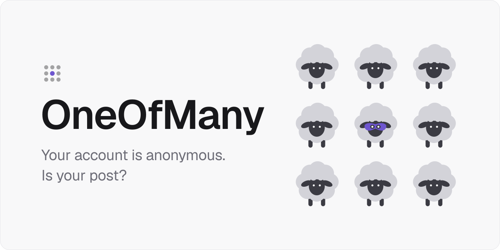
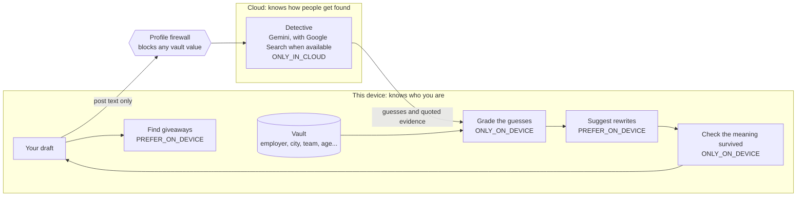
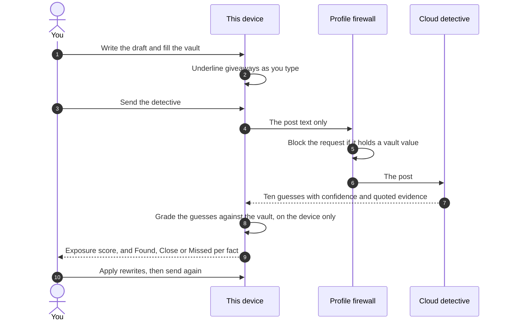

<p align="center">
  <picture>
    <source media="(prefers-color-scheme: dark)" srcset="docs/readme/hero-dark.svg">
    
  </picture>
</p>

<h3 align="center">Your account is anonymous. Is your post?</h3>

<p align="center">
  OneOfMany sends an AI detective after your draft before anyone else reads it.<br>
  The cloud sees only your words. Who you really are stays on your device.
</p>

<p align="center">
  <a href="https://one-of-many-sigma.vercel.app"><b>Live app</b></a> ·
  <a href="#how-it-works"><b>How it works</b></a> ·
  <a href="#privacy-by-design"><b>Privacy</b></a>
</p>

<p align="center">
  <a href="https://github.com/SrijaMalhar/OneOfMany/actions/workflows/check.yml"></a>
  <a href="LICENSE"></a>
  <a href="https://firebase.google.com/docs/ai-logic"></a>
  <a href="https://developer.chrome.com/docs/ai/built-in"></a>
  <a href="tsconfig.app.json"></a>
</p>

<!-- The demo GIF goes here once it's recorded on the live site: docs/readme/demo.gif -->

## The problem

> [!IMPORTANT]
> Removing your name doesn't make a post anonymous. The details do the work: "the only woman engineer on the settlement team", "our office in Bellandur", "since the reorg in March".

AI has made those details much easier to exploit:

- **Nov 2026, Northeastern University.** Researchers built 822 fictional interviews from public information about people found through Reddit AMAs, removed the names, and asked AI models to identify the speakers. The strongest systems identified roughly 400. ([Northeastern Global News](https://news.northeastern.edu/2026/11/24/ai-identify-anonymous-users/))
- **ICLR 2024, ETH Zurich.** Language models inferred location, income and sex from real Reddit profiles with up to 85% top-1 accuracy, far faster and cheaper than people. ([arXiv 2310.07298](https://arxiv.org/abs/2310.07298))
- **2026, Lermen et al.** LLM agents worked out where people live and what they do from a handful of comments, then searched the web for them. ([summary](https://simonlermen.substack.com/p/large-scale-online-deanonymization))

OneOfMany is for anyone who needs to say something without being identified: employees writing about their workplace, nurses reporting unsafe conditions, students writing about advisors, people in support communities, and journalists publishing anonymised quotes.

Existing tools either strip names with pattern matching, or "anonymise" your text by sending your raw, identifying draft to a cloud AI. Neither tests the draft against a realistic attacker, and the second hands your identity to a third party in order to protect it.

## What it does

<!-- Screenshots from the live site go above each paragraph, light and dark, in <picture> elements:
     docs/readme/giveaways-*.png, docs/readme/file-*.png, docs/readme/rewrites-*.png -->

<table>
  <tr>
    <td width="33%" valign="top">
      <p><b>Find the giveaways.</b> As you type, rules and Gemini Nano underline every detail that narrows you down, from a dotted line for a small clue to red for the words the detective used. Blur any of them in one click, with undo.</p>
    </td>
    <td width="33%" valign="top">
      <p><b>Send the detective.</b> A cloud Gemini model reads only your post and guesses ten facts about you, with quotes as evidence. Your device checks which guesses were right, and points at the words that gave each one away.</p>
    </td>
    <td width="33%" valign="top">
      <p><b>Rewrite and test again.</b> Apply suggested rewrites, check that the post still says what you meant, and send the detective again until you're one of many.</p>
    </td>
  </tr>
</table>

## How it works

The interface is split the way the system is split. The left pane is your device: the draft, its giveaways and your vault. The right pane is the cloud: the detective and the file it builds on you. Between them runs a profile firewall, and the header shows how many vault values have crossed it. It should always read 0.



One run, step by step:



1. **Write.** Deterministic rules and Gemini Nano underline each giveaway as you type. On-device inference is free and works offline, so this runs on every pause.
2. **Send the detective.** A cloud Gemini model plays a skilled investigator. It sees only the post and returns guesses for ten facts (employer, industry, city, country, team, role, seniority, time at the job, age and gender) with confidence, quoted evidence and a rough size of the crowd you'd hide in. Earlier posts from the same account can be added, because clues add up across posts. If a model is slow or unavailable, the detective steps down to the next one and remembers that for the session.
3. **Grade privately.** Gemini Nano compares each guess with your vault, on your device. Synonyms and old names count ("Bangalore" is "Bengaluru"). Wrong guesses are never shown.
4. **Rewrite.** Nano suggests vaguer wording for each giveaway, shown as a diff. A **meaning kept** check then compares the rewrite with your original on the device, so you don't scrub away your own point.
5. **Test again.** Every run is kept, so you can watch exposure fall run by run.

## Why hybrid, job by job

| Job | Inference mode | Why this mode |
| --- | --- | --- |
| Find giveaways | `PREFER_ON_DEVICE` | Runs on every pause in typing, so it must be free and work offline. The draft is about to be public, so a cloud fallback is acceptable, but without a local model it only runs when you ask. |
| Detective | `ONLY_IN_CLOUD`, plus Google Search when the plan allows | A real attacker uses the strongest model and the web. The attack only means something if the attacker doesn't know the answer, so it never gets the vault. |
| Grade guesses | `ONLY_ON_DEVICE` | The prompt contains your vault. There is no cloud fallback: without Nano, deterministic matching grades instead and you can correct any row. |
| Suggest rewrites | `PREFER_ON_DEVICE` | Clues sent for rewriting come from the detective's evidence and high-risk giveaways, never from the vault or from which guesses were right, so even a cloud fallback learns nothing new. |
| Meaning kept | `ONLY_ON_DEVICE` | Compares the original with the rewrite. The original holds the clues you chose not to publish, so it doesn't go anywhere again. Without Nano, a deterministic check answers instead. |

Every result shows its real `inferenceSource` from the SDK, never a guess: "On this device" or "In the cloud".

## Privacy by design

<!-- The receipt screenshot goes here, floated right, once it's captured: docs/readme/receipt-*.png -->

- **Two kinds of data, two places.** What you're about to publish may go to the cloud. Who you are never does.
- **Profile firewall.** Every cloud-capable request passes through [`src/engine/firewall.ts`](src/engine/firewall.ts). If it contains a vault value that isn't already in your public text, it's blocked before it's sent.
- **Receipt.** A side sheet lists every AI call in the tab: task, routing, real inference source, latency, firewall result and the exact text sent. It re-audits every cloud payload against the vault, independently of the firewall.
- **Firewall self-test.** One click builds a request that contains a vault value and pushes it through the real firewall, to a stub that can't reach the network.
- **Device-only means device-only.** Before any `ONLY_ON_DEVICE` job, the app checks Chrome's `LanguageModel` availability itself and refuses to send if no local model is ready.
- **Nothing stored server-side.** Firestore holds a single opt-in counter of giveaway types. No text, no vaults, no accounts beyond anonymous auth.
- **No names, ever.** The detective is told never to output names, usernames, emails, phone numbers or addresses, and its output schema has no field for them.

<!-- Results: run the 30-post benchmark at #bench, click Download JSON, then run
     node scripts/benchmark-chart.mjs <file>
     It draws docs/readme/benchmark-light.svg and benchmark-dark.svg and prints the table for a "## Results" section here. -->

## Try it

1. Open the [live app](https://one-of-many-sigma.vercel.app) in desktop Chrome.
2. Pick a sample under **Try a sample**. The people and employers are fictional.
3. Click **Send the detective**, or press Cmd or Ctrl + Enter.
4. Click **Suggest rewrites**, apply them, and send the detective again. Open **Receipt** to see every call and run the firewall test.

> [!TIP]
> Gemini Nano is optional. Without it, grading and the meaning check use deterministic rules, and the giveaway scan offers a deep scan in the cloud.

<details>
<summary><b>Turn on Gemini Nano in Chrome</b></summary>
<br>

1. In `chrome://flags`, enable **Prompt API for Gemini Nano** (on newer Chrome, also **Gemma 4 for Built-in AI**) and **Prompt API for Gemini Nano with Multimodal Input**, then relaunch Chrome.
2. In the app, click **Download Gemini Nano** at the bottom of the vault, once. Keep Chrome open until the header says **Gemini Nano: Ready**. `chrome://on-device-internals` shows progress.

Gemini Nano needs at least 22 GB of free storage and either a GPU with more than 4 GB of VRAM, or 16 GB of RAM with 4 CPU cores.

</details>

## Run it locally

Requires Node 22.12 or newer and desktop Chrome.

```bash
git clone https://github.com/SrijaMalhar/OneOfMany.git
cd OneOfMany
cp .env.example .env.local   # fill in your Firebase values
npm install
npm run dev                  # http://localhost:5173
```

<details>
<summary><b>Set up Firebase</b></summary>
<br>

1. **Project.** In the [Firebase console](https://console.firebase.google.com), create a project. Open **AI Services > AI Logic**, click **Get started** and choose the **Gemini Developer API**. Google Search grounding needs the Blaze plan; without it the detective works from the text alone and says so.
2. **Web app.** Under **Project settings > Your apps**, add a **Web** app and copy its config into `.env.local`.
3. **App Check.** Register the web app with **reCAPTCHA Enterprise** (a key for `localhost` and your domains), then enforce App Check for **Firebase AI Logic**.
4. **Firestore and Auth.** Create a Firestore database in production mode, and enable the **Anonymous** sign-in provider.
5. **Debug token.** On first run the browser console prints an App Check debug token. Add it under **App Check > Apps > Manage debug tokens** and set it as `VITE_APPCHECK_DEBUG_TOKEN` in `.env.local`. Only the dev server uses it.

</details>

<details>
<summary><b>Deploy</b></summary>
<br>

**Vercel.** Import the repo in Vercel; `vercel.json` sets the build. Add the `VITE_FIREBASE_*` values and `VITE_RECAPTCHA_ENTERPRISE_SITE_KEY` as environment variables (never the debug token), and add the Vercel domain to the reCAPTCHA Enterprise key. Firestore rules and the Remote Config template deploy with the Firebase CLI:

```bash
firebase deploy --only firestore:rules,remoteconfig
```

**Firebase Hosting** works too:

```bash
npm install -g firebase-tools
firebase login
firebase use <your-project-id>
npm run deploy
```

</details>

Run the checks with `npm run check`: type check, lint, and tests for the deterministic engine, the receipt audit, the firewall self-test and the benchmark summary. The same checks run on every push.

The benchmark lives at `#bench` in the app: 30 fictional posts, each attacked, rewritten and attacked again, graded by the deterministic rules so anyone can reproduce the numbers.

## Built with Firebase

| Product | Where | What it does here |
| --- | --- | --- |
| **Firebase AI Logic** (hybrid inference) | [`models.ts`](src/ai/models.ts), [`run.ts`](src/ai/run.ts), [`tasks.ts`](src/ai/tasks.ts) | A model per job with its own `InferenceMode`; structured JSON on both paths; Google Search grounding; `initializeDeviceModel()` for the one-time Nano download |
| **App Check** | [`firebase.ts`](src/firebase.ts) | reCAPTCHA Enterprise protects the Gemini API from abuse |
| **Remote Config** | [`firebase.ts`](src/firebase.ts), [`remoteconfig.template.json`](remoteconfig.template.json) | Detective model, fallback model, search, confidence threshold and the meaning check can change live |
| **Authentication** | [`firebase.ts`](src/firebase.ts) | Anonymous sign-in for the opt-in counter |
| **Cloud Firestore** | [`store.ts`](src/store.ts), [`firestore.rules`](firestore.rules) | Opt-in counts of giveaway types, with rules that only allow small increments |

Where Firebase AI Logic is called at runtime:

- `getGenerativeModel(ai, { mode, inCloudParams, onDeviceParams })` in [`src/ai/models.ts`](src/ai/models.ts)
- `model.generateContent(prompt)` and `response.inferenceSource` in [`src/ai/run.ts`](src/ai/run.ts)
- `model.initializeDeviceModel(onProgress)` in [`src/ai/models.ts`](src/ai/models.ts)
- One JSON Schema per job, passed as `responseConstraint` (Chrome Prompt API) and `responseJsonSchema` (Gemini), in [`src/ai/schemas.ts`](src/ai/schemas.ts)

<details>
<summary><b>Project structure</b></summary>
<br>

```
src/
  ai/          one model per job, the firewall check, the device-only guard, prompts, schemas, the receipt
  engine/      deterministic and tested, no AI: giveaways, grading, firewall, fixes, meaning kept
  bench/       30 fictional cases, the runner and the benchmark page
  ui/          front door, editor, giveaways, vault, detective, file, rewrites, receipt, How it works
  Root.tsx     routes: the front door, the tool at #check, the benchmark at #bench
  App.tsx      the two panes: this device and the cloud
  firebase.ts  App Check, AI Logic, Auth, Firestore, Remote Config
  store.ts     local vault, session drafts, opt-in counters
scripts/       README art and the benchmark chart
docs/readme/   images used in this README
```

</details>

## Known limits

We'd rather name these than have you find them:

- **Confirmation misuse.** Someone could paste another person's post and fill the vault with their guesses about that person. Hiding wrong guesses and asking you to confirm the draft is your own reduce this, but don't prevent it.
- **Differences between drafts.** The cloud sees every version you test. Suggested rewrites are chosen without the vault and each detective call is stateless, but edits you make by hand could map to correct guesses.
- **One run is one sample.** Two runs on the same text can differ. Treat a low score as "harder to find", not "safe".
- **Up to three earlier posts.** Real attackers can read an account's whole history.
- **Text only.** Posting times, account history, writing style and file metadata can also identify you.
- **The cloud provider processes your draft,** which is text you intend to publish. Your vault never leaves the device.

## Why the name

<picture>
  <source media="(prefers-color-scheme: dark)" srcset="docs/readme/nobody-dark.svg">
  
</picture>

In the Odyssey, Odysseus tells the one-eyed Cyclops that his name is Nobody, then slips out of the cave hidden among the flock. OneOfMany does the same for your post: the cloud detective gets your words, never your name, and you leave as one of many. The sheep in the mask is Nobody. On the app's front page, a crowd of sheep thins out one detail at a time until only Nobody is left.

<br clear="right">

## What's next

- A Chrome extension that adds "Check before posting" to Reddit, Glassdoor and other comment boxes, using the same engine.
- An Android client with Gemini Nano through Firebase AI Logic, sharing the vault design.
- Writing-style giveaways: measuring and flattening style fingerprints, not only facts.

## License

Apache-2.0. See [LICENSE](LICENSE). Built by [Srija Malhar](https://github.com/SrijaMalhar).

<p align="center">
  <picture>
    <source media="(prefers-color-scheme: dark)" srcset="docs/readme/nobody-dark.svg">
    
  </picture>
</p>
